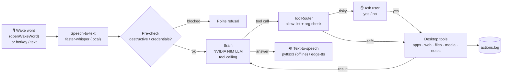

<p align="center"></p>

<p align="center">
  
  
  
  
  
</p>

# Jarvis Desktop Assistant

A personal, **safety-first voice assistant that runs on your own Windows PC**. Say *"Hey Jarvis"* (or press a hotkey, or just type), and it transcribes your voice locally with Whisper, reasons with an LLM on **NVIDIA NIM** using OpenAI-style **tool calling**, acts through a small **allow-list of desktop tools**, and answers out loud.

> Built as an agentic-AI portfolio project, reusing the NIM setup from my [DevOpsDesk](https://github.com/rohit-dev45/devops-desk) project.

## What it can do

| Ask | Tool | Notes |
|---|---|---|
| "Open Notepad / VS Code / Calculator" | `open_app` | Only apps on an allow-list |
| "Open YouTube" / "open github.com" | `open_website` | http/https only |
| "Search the web for .NET 9 features" | `web_search` | Opens a browser search (can be turned off) |
| "Find my resume" | `search_files` | Desktop, Documents, Downloads; read-only |
| "How's my battery / CPU?" "What time is it?" | `system_info`, `get_time` | via `psutil` |
| "Volume up", "pause music", "next track" | `media_control` | Windows media keys |
| "Note: call the recruiter at 4" / "read my notes" | `take_note`, `read_notes` | Saved to `~/.jarvis/notes.md` |
| "Remind me in 20 minutes to stretch" | `set_reminder` | Works while Jarvis is running |
| "Run ipconfig" | `run_shell` | Read-only commands only, **asks you first** |

Three ways to talk to it:
- **Text mode** (default): type in a terminal, no microphone needed.
- **Push-to-talk**: press `Ctrl+Alt+J`, speak for ~5 seconds.
- **Wake word**: say *"Hey Jarvis"* (free, keyless [openWakeWord](https://github.com/dscripka/openWakeWord) model).

## Architecture



```
jarvis/
  __main__.py   CLI: --text | --hotkey | --wake
  brain.py      NIM chat loop with tool calling (max 5 steps)
  router.py     tool registry, allow-list, confirmation gate, logging
  safety.py     blocked patterns, read-only shell rules, action log
  tools.py      desktop actions (Windows calls guarded for other OSes)
  voice.py      openWakeWord, faster-whisper, pyttsx3 / edge-tts
  reminders.py  in-process timers
tests/          router, safety and LLM-loop tests with a mock LLM
```

## Safety by design

- **Allow-list only.** The LLM can call only the tools registered in `router.py`; anything else is rejected and logged.
- **No delete tool exists.** Requests mentioning delete/wipe/format/remove-item/shutdown are refused before reaching the LLM or a tool.
- **Confirmation for risky actions.** `run_shell` asks *"Allow? yes/no"* and even then runs only single read-only commands (`dir`, `ipconfig`, `systeminfo`, `tasklist`, `ping`, …) with no pipes, `&&` or redirection.
- **No credentials.** Arguments mentioning passwords, API keys, tokens or secrets are blocked. Your NIM key is read from `.env` and never passed to tools.
- **Audit log.** Every tool call, with status `ok / blocked / declined / error`, is appended to `~/.jarvis/actions.log`.

## Setup on Windows

1. Install **Python 3.10–3.12** from [python.org](https://www.python.org/downloads/windows/) and tick **"Add python.exe to PATH"**.
2. Get a free API key at **[build.nvidia.com](https://build.nvidia.com)** → sign in → open any model → **Get API Key** (starts with `nvapi-`).
3. Download this repo: **Code → Download ZIP** and extract it, or
   ```powershell
   git clone https://github.com/rohit-dev45/jarvis-desktop-assistant.git
   cd jarvis-desktop-assistant
   ```
4. Double-click **`run.bat`** (or run it from PowerShell). The first run creates a virtual environment, installs everything, copies `.env.example` to `.env` and opens it in Notepad. Paste your key into `NVIDIA_API_KEY=` and save.
5. Run it again:
   ```powershell
   .\run.bat            # text mode
   .\run.bat --hotkey   # push-to-talk with Ctrl+Alt+J
   .\run.bat --wake     # say "Hey Jarvis"
   ```
   The first voice run downloads the Whisper and wake-word models (a few hundred MB for `base.en`).

Manual alternative: `py -m venv .venv`, `.venv\Scripts\activate`, `pip install -r requirements.txt`, `$env:NVIDIA_API_KEY="nvapi-..."`, `python -m jarvis`.

## Run the tests

```bash
pip install -r requirements-dev.txt
pytest -q
```
The tests use a mock LLM, so they need no API key, microphone or Windows.

## Limitations (honest)

- Tested on **Linux** with the mock LLM (17 passing tests) and the text-mode startup path. **Windows audio (mic, wake word, TTS), app launching and media keys have not been tested by me on a real Windows machine yet.**
- The `keyboard` hotkey may need the terminal to run as Administrator on some setups.
- Reminders live in memory and vanish when Jarvis closes.
- Tool calling quality depends on the NIM model you pick; switch with `NVIDIA_MODEL`.
- Not a replacement for a full OS automation agent: it can't click inside apps, fill forms or manage files.

## Roadmap

- System-tray icon and a small GUI
- Persistent reminders via Windows Task Scheduler
- Conversation memory across sessions
- Calendar and email read-only integrations

## License

MIT © Botta Rohit Yadav
